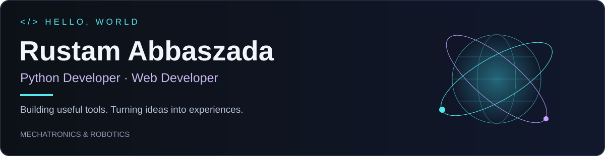
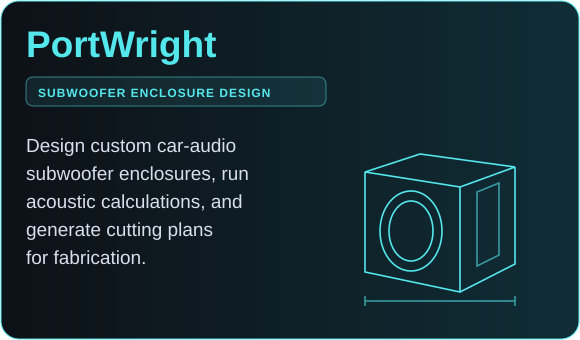
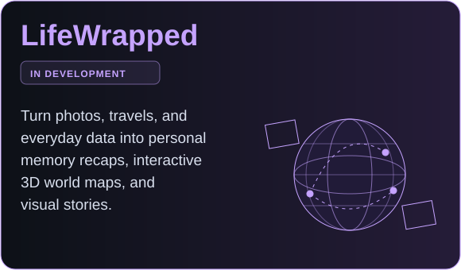

  

  
  

I'm **Rustam**, a Python developer and freelance web developer with a background in **Mechatronics and Robotics Engineering**. I enjoy building practical tools and turning ideas into useful experiences.

## Tech Stack

  
  
  
  
  
  
  

## Featured Projects

  
  

### PortWright

An application for designing custom **car-audio subwoofer enclosures**, performing **acoustic calculations**, and generating **cutting plans for fabrication**.

### LifeWrapped · In Development

An application that analyzes **photos, travels, and everyday life data** to create **personalized memory recaps**, **interactive 3D world maps**, and **visual stories**.

---

<i>Code. Learn. Build. Repeat.</i>

